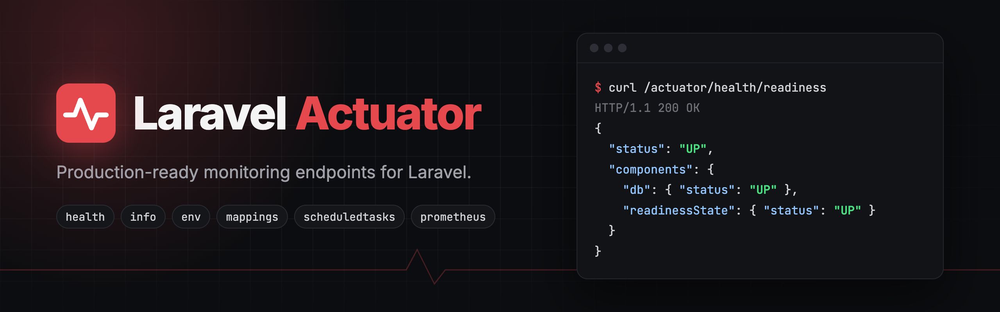

<p align="center">
  
</p>

# Laravel Actuator

[](https://packagist.org/packages/nwidart/laravel-actuator)
[](LICENSE.md)
[](https://github.com/nwidart/laravel-actuator/actions/workflows/php.yml)
[](https://packagist.org/packages/nwidart/laravel-actuator)

Production-ready endpoints to monitor your Laravel application: health checks for Kubernetes probes and load balancers, metrics for Prometheus, build and runtime info, configuration, routes and scheduled tasks.

**Documentation: [nwidart.github.io/laravel-actuator](https://nwidart.github.io/laravel-actuator/)**

## Requirements

- PHP 8.2 or later
- Laravel 12 or 13
- Redis for the metrics in production

## Installation

```bash
composer require nwidart/laravel-actuator
```

The service provider registers itself. To change the defaults, publish the configuration file:

```bash
php artisan vendor:publish --tag=actuator-config
```

## Usage

The `health` endpoint is exposed at once:

```bash
curl http://localhost/actuator/health
```

```json
{"status": "UP", "groups": ["liveness", "readiness"]}
```

`/actuator/health/liveness` and `/actuator/health/readiness` are ready for Kubernetes probes.

The other endpoints (`info`, `env`, `mappings`, `scheduledtasks` and `prometheus`) reveal details about your application, so they are not exposed by default. Protect them with middleware, then expose them in `config/actuator.php`:

```php
'exposure' => [
    'include' => ['health', 'info', 'prometheus'],
],

'info' => [
    'middleware' => ['web', 'auth', 'can:viewActuator'],
],
```

Define the `viewActuator` gate in your application, as [secure endpoints](https://nwidart.github.io/laravel-actuator/guides/secure-endpoints/) shows.

Metrics are recorded with no code. Point [Prometheus](https://prometheus.io) at `/actuator/prometheus` to scrape them.

## Learn more

The [documentation](https://nwidart.github.io/laravel-actuator/) covers the rest:

- [Tutorial: your first health check](https://nwidart.github.io/laravel-actuator/tutorial/)
- [Expose](https://nwidart.github.io/laravel-actuator/guides/expose-endpoints/) and [secure](https://nwidart.github.io/laravel-actuator/guides/secure-endpoints/) endpoints
- [Configure health indicators](https://nwidart.github.io/laravel-actuator/guides/configure-health-indicators/) and [write your own](https://nwidart.github.io/laravel-actuator/guides/write-a-health-indicator/)
- [Kubernetes probes](https://nwidart.github.io/laravel-actuator/guides/kubernetes-probes/)
- [Monitor queues](https://nwidart.github.io/laravel-actuator/guides/monitor-queues/) and [the scheduler](https://nwidart.github.io/laravel-actuator/guides/monitor-the-scheduler/)
- [Collect metrics with Prometheus](https://nwidart.github.io/laravel-actuator/guides/collect-metrics-with-prometheus/), [record custom metrics](https://nwidart.github.io/laravel-actuator/guides/record-custom-metrics/) and the [Grafana dashboard](https://nwidart.github.io/laravel-actuator/guides/grafana-dashboard/)
- [Write a custom endpoint](https://nwidart.github.io/laravel-actuator/guides/write-a-custom-endpoint/)
- [Configuration reference](https://nwidart.github.io/laravel-actuator/reference/configuration/)

## Testing

```bash
composer test
composer analyse
composer lint
```

## Changelog

Please see [CHANGELOG](CHANGELOG.md) for more information on what has changed recently.

## Contributing

Please see [CONTRIBUTING](CONTRIBUTING.md) for details.

## Security

If you discover any security related issues, please email n.widart@gmail.com instead of using the issue tracker.

## Credits

- [Nicolas Widart](https://github.com/nwidart)
- [All Contributors](../../contributors)

## License

The MIT License (MIT). Please see [License File](LICENSE.md) for more information.
